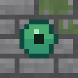
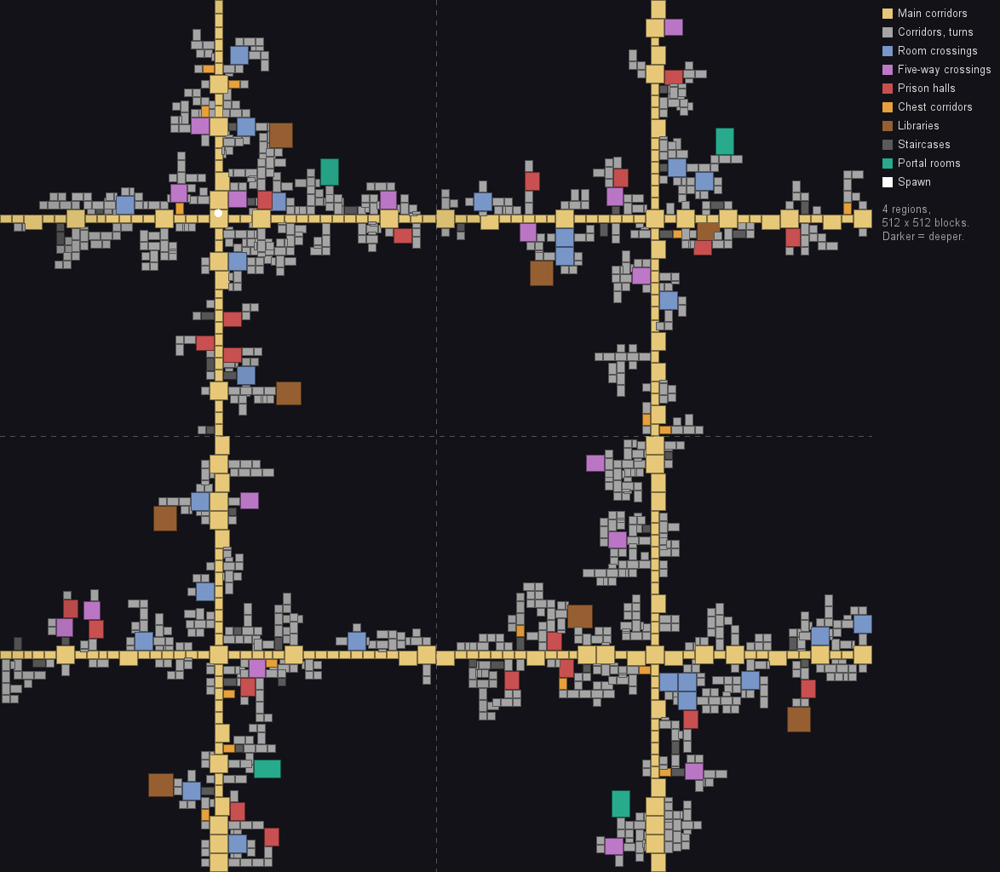

# Endless Stronghold



A Fabric mod for Minecraft Java Edition 26.3 that adds a world type where the Overworld is one vanilla stronghold, floating in the void, that never ends.

- **Vanilla's stronghold, exactly.** Every room is vanilla's piece, block for block: corridors, turns, prison halls, room crossings (pillar, fountain, storeroom), five-way crossings, chest corridors, libraries, both kinds of staircase, and portal rooms. Cracked, mossy and infested bricks, vanilla's doors, vanilla's loot.
- **Grown the way vanilla grows one.** Piece by piece, with vanilla's weights, limits and rules, and every doorway at its real height.
- **Endless.** The world is split into 256 × 256 block regions. Each grows its own stronghold, and main corridors made of vanilla's pieces join them into one that goes on forever.
- **A way to the End in every region.** Each region has a portal room, with its silverfish spawner. Eyes of ender and `/locate structure endless_stronghold:portal_room` find the nearest one.
- **Fast.** It generates about five times faster than a normal Overworld.



*Four regions of seed 12345 from above, coloured by room type. The main corridors cross each region and meet the next; the stronghold branches off them, as vanilla's does.*

The full plan is in [DESIGN.md](DESIGN.md); changes to it are in [DECISIONS.md](DECISIONS.md); what's new in each version is in [CHANGELOG.md](CHANGELOG.md).

## Playing it

1. Install Fabric Loader for Minecraft 26.3 from [fabricmc.net](https://fabricmc.net/use/installer/).
2. Download [Fabric API](https://modrinth.com/mod/fabric-api) for 26.3.
3. Get the Endless Stronghold jar from the [latest release](https://github.com/TyceG/Endless-stronghold-/releases), or from the newest run on the [Actions tab](https://github.com/TyceG/Endless-stronghold-/actions) (download **Artifacts** at the bottom and unzip it; use `endless-stronghold-<version>.jar`, not the `-sources` one).
4. Put both jars in the `mods` folder of your Minecraft folder.
5. Start the Fabric 26.3 profile, choose **Create New World**, and on the **World** tab set **World Type** to **Endless Stronghold**.

You spawn in a lit pillar room at the centre of the first region. Monsters spawn in the dark rooms. Throw an eye of ender to find the nearest portal room.

For a dedicated server, put both jars in its `mods` folder and set `level-type=endless_stronghold:endless_stronghold` in `server.properties` before the world is first created.

## Settings

The world preset sets two heights, which you can change with a data pack that replaces `data/endless_stronghold/worldgen/world_preset/endless_stronghold.json`, chosen when the world is created:

```json
"settings": {
  "hub_y": 30,
  "lowest_y": -24
}
```

- `hub_y`: the floor of each region's central room, where the main corridors start and you spawn.
- `lowest_y`: the lowest any room may reach (vanilla stops 54 blocks below its start). At least 12 below `hub_y`.

## Building

Needs JDK 25.

```
./gradlew build
```

The jar lands in `build/libs/`. `./gradlew test` runs the unit tests: vanilla's growth rules region by region, the main corridors meeting, finding the nearest portal room, and a walk from spawn through two whole regions.

### Server tests

`./gradlew runSmokeServer` starts a headless 26.3 server in `run/smoke`, creates an Endless Stronghold world, generates every chunk within 256 blocks of spawn, checks the spawn point and the portal room's spawner, opens a chest of each loot table, follows an eye of ender to the nearest portal room and lights its portal, logs `[smoke] PASS` or `[smoke] FAIL`, and stops.

`./gradlew runBenchServer` times the same chunks in a normal Overworld in `run/bench`, to compare.

Before the first run, create `eula.txt` containing `eula=true` in each folder (this accepts the [Minecraft EULA](https://www.minecraft.net/eula)), and a `server.properties` with `level-type=endless_stronghold\:endless_stronghold` (smoke) or `level-type=minecraft\:normal` (bench). Delete the `world` folder to test a fresh world.

The icon and map are drawn by `tools/Icon.java` and `tools/MapRender.java`.

## License

CC0 1.0, as in the Fabric example mod.
